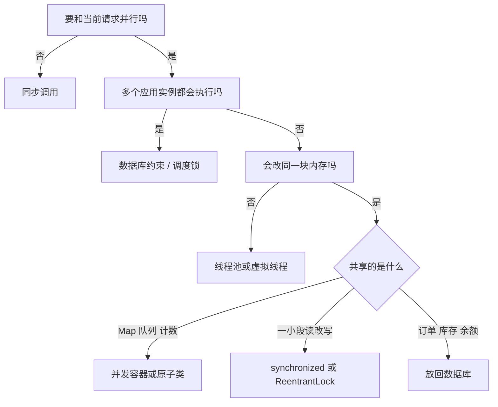

# Spring 项目中如何优雅使用锁和多线程

这份文档只谈业务项目里会反复遇到的写法：线程放进 Spring 容器、锁只保护真正共享的那一小段、多实例部署时不拿 JVM 锁冒充全局互斥。

## 1. 先判断要不要用

多线程和锁解决两件不同的事。

- **多线程**：同时做多件耗时的事，比如并行调几个下游、生成报表、发通知。
- **锁**：多段代码同时改同一份可变数据时，保证读改写不被打断。

Spring 的 `@Service`、`@Component` 默认是单例。单例里的实例字段，会被所有请求一起读写。锁几乎都是为这种字段准备的。方法里的局部变量每个调用各有一份，不需要锁。

按这个顺序决定：

1. 这件事必须和当前请求并行吗？不必须，就保持同步调用。
2. 必须并行时，任务之间会改同一块内存吗？不会，只上线程池或虚拟线程。
3. 会改，而且只是 Map、队列、计数器：用并发容器或原子类。
4. 会改，而且是一小段必须连在一起的读改写：用 `synchronized` 或 `ReentrantLock`。
5. 改的是订单、库存、余额：写进数据库，用事务、唯一约束或版本号。应用若部署了多个实例，JVM 里的锁只在当前进程生效。



## 2. 多线程

### 2.1 线程池注册成 Bean

每个业务一条有界线程池，线程名带业务前缀。池子跟着 Spring 容器启动和关闭。

不要用 `Executors.newFixedThreadPool`、`newCachedThreadPool` 做业务池：队列或线程数没有上限，也接不上 Spring 的停机过程。

```java
@EnableAsync
@Configuration
public class AsyncExecutorConfig {

    @Bean("bizExecutor")
    public ThreadPoolTaskExecutor bizExecutor() {
        // Spring 的线程池包装。内部仍是 JDK 的 ThreadPoolExecutor，
        // 多接了容器启动、关闭，以及 @Async 要用的任务装饰。
        ThreadPoolTaskExecutor executor = new ThreadPoolTaskExecutor();
        // 平时保留 8 条线程。有任务先用它们；都在忙，新任务进入下面的队列。
        executor.setCorePoolSize(8);
        // 队列满了之后才继续加线程，最多 16 条。
        // 接纳顺序：核心线程 -> 队列 -> 加到最大线程 -> 拒绝。
        executor.setMaxPoolSize(16);
        // 核心线程都在忙时，最多再排队 200 个还没开始的任务。数字有上限，避免任务无限堆在内存里。
        executor.setQueueCapacity(200);
        // 超出 8 条的那些线程，空闲 60 秒后回收。核心线程默认一直留着。
        executor.setKeepAliveSeconds(60);
        // 日志和线程转储里会看到 biz-async-1、biz-async-2，能认出是这条池。
        executor.setThreadNamePrefix("biz-async-");
        // 16 条都在忙、队列里也有 200 个时，由提交任务的那条线程自己执行。
        // 任务不丢，提交方会被拖慢，后面的请求自然变慢。
        executor.setRejectedExecutionHandler(new ThreadPoolExecutor.CallerRunsPolicy());
        // 应用关闭时，已经在跑的和还排着队的任务继续做完，不再接收新任务。
        executor.setWaitForTasksToCompleteOnShutdown(true);
        // 关闭时最多再等 30 秒。到点还没做完，就继续关闭。
        executor.setAwaitTerminationSeconds(30);
        // 任务交到工人线程之前，抄一份追踪号和登录用户；做完清空。见 2.4。
        executor.setTaskDecorator(new ContextCopyingDecorator());
        return executor;
    }
}
```

`new ThreadPoolTaskExecutor()` 只是把池子先造出来，真正开始接任务要等 Spring 创建这个 Bean 之后。选择它，是因为业务池要同时满足四件事：线程数和队列有上限、应用关闭时把在途任务做完、`@Async("bizExecutor")` 能按名字找到它、提交前能抄追踪号和登录用户。它实现了 `Executor`，所以 `CompletableFuture.supplyAsync(..., bizExecutor)` 也能用同一个池。

还可以这样建池：

| 写法 | 适合什么时候 |
|---|---|
| `ThreadPoolTaskExecutor`，也就是上面这段 | 业务里要限流、要停机等任务、要给 `@Async` 用 |
| `new ThreadPoolExecutor(8, 16, 60, SECONDS, new ArrayBlockingQueue<>(200), handler)` | 不用 Spring 的包装，参数和上面是同一套。停机要自己在 `@Bean(destroyMethod = "shutdown")` 里接上 |
| Spring Boot 配置 `spring.task.execution.pool.core-size` 等 | 整个应用只用一条默认异步池时，可以不写 Java 配置 |
| `Executors.newFixedThreadPool` / `newCachedThreadPool` | 临时小程序可以。固定池的等待队列没有上限，缓存池的线程数没有上限，也接不上上面的停机等待 |
| `Executors.newVirtualThreadPerTaskExecutor()` | Java 21 起、大量阻塞等待时。不再设置核心数、最大数和队列，并发上限改用 `Semaphore` |

同一套数字用 JDK 原生池写出来是这样，行为对应上面的核心线程、最大线程、空闲回收、有界队列和拒绝策略：

```java
@Bean(destroyMethod = "shutdown")
public ExecutorService bizExecutor() {
    return new ThreadPoolExecutor(
            8,
            16,
            60, TimeUnit.SECONDS,
            new ArrayBlockingQueue<>(200),
            new ThreadPoolExecutor.CallerRunsPolicy());
}
```

这段没有线程名前缀，也没有 `TaskDecorator`。要日志里的 `biz-async-` 和追踪号，还是用前面的 `ThreadPoolTaskExecutor`。

配套停机配置：

```yaml
server:
  shutdown: graceful

spring:
  lifecycle:
    timeout-per-shutdown-phase: 30s
```

参数按下游承受能力定，而不是按「越大越快」定。

| 任务 | 池的规模 |
|---|---|
| 纯计算 | 接近 CPU 核数 |
| 阻塞 IO（查库、调 HTTP） | 可以大于核数，上限对齐下游连接数和配额 |
| 导出、报表、通知 | 单独一条池，避免拖住下单主流程 |

`CallerRunsPolicy` 的含义是：池和队列都满时，由提交任务的那条线程自己执行。任务不会被悄悄丢掉，提交速度会被自然拖慢。若连调用方线程也不能堵，就换成自己的拒绝策略：打错误日志、记指标、把失败交给业务上的重试或补偿。

不同业务分开建池，例如 `orderExecutor`、`notifyExecutor`。一条池被慢任务占满时，另一条仍然能跑。

### 2.2 `@Async` 的用法

`@Async` 要标在另一个 Spring Bean 的 public 方法上，并通过注入的代理调用。同一个类里 `this.send()` 不会进入代理，方法会在当前线程同步执行。

```java
@Service
public class NotifyService {

    @Async("bizExecutor")
    public void send(Long orderId) {
        // 发短信、发邮件、写非关键日志
    }
}
```

调用方：

```java
@Service
public class OrderAppService {

    private final NotifyService notifyService;

    public OrderAppService(NotifyService notifyService) {
        this.notifyService = notifyService;
    }

    public void place(Order order) {
        orderRepository.save(order);
        notifyService.send(order.getId());
    }
}
```

返回值按调用方是否需要结果来选。

- 不关心结果：返回 `void`。异常不会回到调用方，必须配 `AsyncUncaughtExceptionHandler`，否则失败只留在线程里。
- 关心结果：返回 `CompletableFuture<T>`。异常在 Future 上，调用方用 `exceptionally` / `handle` 处理。这种返回值**不会**走 `AsyncUncaughtExceptionHandler`。

```java
@Configuration
public class AsyncExceptionConfig implements AsyncConfigurer {

    @Override
    public AsyncUncaughtExceptionHandler getAsyncUncaughtExceptionHandler() {
        return (ex, method, params) ->
            LoggerFactory.getLogger(method.getDeclaringClass())
                .error("async failed, method={}", method.getName(), ex);
    }
}
```

`@Async` 方法里把工作做完再返回即可。不要在里面再套一层 `CompletableFuture.supplyAsync`，否则任务会被调度两次。

### 2.3 事务提交之后再异步

`@Async` 方法一调用就会另起线程。若写在 `save` 之后、事务提交之前，异步线程可能读不到新数据，也可能在事务最终回滚后仍然发出通知。

事务还开着时，把异步调用登记到提交之后：

```java
public void place(Order order) {
    orderRepository.save(order);
    Long orderId = order.getId();
    if (TransactionSynchronizationManager.isSynchronizationActive()) {
        TransactionSynchronizationManager.registerSynchronization(new TransactionSynchronization() {
            @Override
            public void afterCommit() {
                notifyService.send(orderId);
            }
        });
    } else {
        notifyService.send(orderId);
    }
}
```

`afterCommit()` 运行在提交事务的那条线程上，里面只做一次提交任务，不要把发短信本身写在这里。

异步方法上的 `@Transactional` 是一个新事务，和调用方事务互不隶属。调用方回滚不会带回异步事务里已经提交的修改。

### 2.4 传递日志和登录态

线程池会复用线程。`TraceId`、登录用户存在 `ThreadLocal` 里时，不拷贝就会丢；不清理就会串到下一个任务。

用 `TaskDecorator` 在提交时拷贝，执行完清理：

```java
public class ContextCopyingDecorator implements TaskDecorator {

    @Override
    public Runnable decorate(Runnable runnable) {
        Map<String, String> mdc = MDC.getCopyOfContextMap();
        SecurityContext securityContext = SecurityContextHolder.getContext();
        return () -> {
            try {
                if (mdc != null) {
                    MDC.setContextMap(mdc);
                }
                SecurityContextHolder.setContext(securityContext);
                runnable.run();
            } finally {
                MDC.clear();
                SecurityContextHolder.clearContext();
            }
        };
    }
}
```

请求结束后才执行的任务，不要依赖 `HttpServletRequest` 和 `RequestContextHolder`。需要的参数在提交时取出来，作为方法参数传进去。

### 2.5 并行编排

几件独立的 IO 要一起等，用同一条业务线程池：

```java
public OrderView load(Long orderId) {
    CompletableFuture<Order> orderFuture =
        CompletableFuture.supplyAsync(() -> orderRepository.findById(orderId).orElseThrow(), bizExecutor);
    CompletableFuture<Payment> paymentFuture =
        CompletableFuture.supplyAsync(() -> paymentClient.findByOrderId(orderId), bizExecutor);

    try {
        return orderFuture.thenCombine(paymentFuture, OrderView::of)
            .get(800, TimeUnit.MILLISECONDS);
    } catch (TimeoutException e) {
        orderFuture.cancel(true);
        paymentFuture.cancel(true);
        throw new BizException("下游超时");
    } catch (ExecutionException e) {
        throw new BizException("加载失败", e.getCause());
    } catch (InterruptedException e) {
        Thread.currentThread().interrupt();
        throw new BizException("加载被中断", e);
    }
}
```

`ForkJoinPool.commonPool()` 和 `parallelStream()` 留给纯计算。阻塞 IO 放进去，会占住全局公共池，拖慢进程里其他并行计算。

### 2.6 虚拟线程

Java 21、Spring Boot 3.2 及以上，大量阻塞 IO 可以直接用虚拟线程，不必为每个下游先算一套平台线程池。

```yaml
spring:
  threads:
    virtual:
      enabled: true
```

开启后，内嵌 Web 服务器用虚拟线程处理请求；没有自定义异步执行器时，`@Async` 也是每个任务一条虚拟线程。

虚拟线程去掉了「线程不够」的问题，去掉不了「下游被打满」的问题。对外部接口仍然要用 `Semaphore`、批量大小或限流器卡住并发。CPU 密集任务继续用第 2.1 节那种小的平台线程池。

### 2.7 定时任务

`@Scheduled` 默认只有一条线程，一个慢任务会挡住后面所有调度。单独给调度器一条池：

```java
@Bean
public TaskScheduler taskScheduler() {
    ThreadPoolTaskScheduler scheduler = new ThreadPoolTaskScheduler();
    scheduler.setPoolSize(4);
    scheduler.setThreadNamePrefix("schedule-");
    scheduler.setWaitForTasksToCompleteOnShutdown(true);
    scheduler.setAwaitTerminationSeconds(30);
    return scheduler;
}
```

同一个任务上一次还没跑完、下一次又触发时，用分布式调度锁保证集群里只有一个实例在执行，见第 4.5 节。

## 3. 锁

锁保护的是内存里的不变量。能把不变量交给并发容器、数据库唯一约束或版本号时，就不再手写锁。

### 3.1 并发容器和原子类

| 共享数据 | 写法 |
|---|---|
| 缓存、按 key 累加 | `ConcurrentHashMap`，原子更新用 `compute` / `merge` |
| 计数、序号、开关 | `AtomicInteger`、`AtomicBoolean`、`LongAdder` |
| 监听器列表，几乎只读 | `CopyOnWriteArrayList` |
| 生产者和消费者交接 | `BlockingQueue`，或 Spring 的消息通道 |

```java
@Service
public class LocalCache {

    private final ConcurrentHashMap<String, Config> configs = new ConcurrentHashMap<>();

    public Config getOrLoad(String key) {
        return configs.computeIfAbsent(key, this::loadFromDb);
    }
}
```

`computeIfAbsent` 的加载函数里不要再改同一个 Map，也不要做可能很慢的远程调用链。加载本身很慢时，缓存交给 Caffeine 这类组件，它自带单飞加载和过期。

下面这种「先查再改」不是原子的，两个请求会互相覆盖：

```java
int n = counter.get();
counter.set(n + 1);
```

改成 `counter.incrementAndGet()`，或者在锁里完成整个读改写。

`volatile` 保证一个字段的写入对其他线程可见，适合「整个对象替换掉」这种发布：

```java
private volatile Snapshot snapshot = Snapshot.EMPTY;

public void replace(Snapshot next) {
    this.snapshot = next;
}
```

它不能单独完成 `if (stock > 0) stock--`。

### 3.2 `synchronized`

一小段读改写，用专用锁对象。锁的范围只包住内存操作。

```java
@Service
public class InMemoryStock {

    private final Object lock = new Object();
    private int stock;

    public boolean deduct() {
        synchronized (lock) {
            if (stock <= 0) {
                return false;
            }
            stock--;
            return true;
        }
    }
}
```

约定：

- 锁专用的 `final` 对象，不锁 `this`，不锁字符串常量。
- 不在锁里查库、调 HTTP、打大日志。远程调用放在锁外面，锁内只做判断和赋值。
- 一个类要拿多把锁时，所有方法按固定顺序获取。

`synchronized` 加在 Spring Bean 的实例方法上，锁的是整个单例。该 Bean 的所有请求会在这把锁上排队。只在确认「整个方法都必须互斥，而且执行很短」时这样写。

### 3.3 `ReentrantLock`

需要等待超时、尝试一次就返回，或多条条件队列时，用 `ReentrantLock`。锁必须是 Bean 的 `final` 字段，放在 `finally` 里释放。

```java
@Service
public class RefreshGate {

    private final ReentrantLock lock = new ReentrantLock();

    public boolean tryRefresh() {
        boolean acquired;
        try {
            acquired = lock.tryLock(50, TimeUnit.MILLISECONDS);
        } catch (InterruptedException e) {
            Thread.currentThread().interrupt();
            return false;
        }
        if (!acquired) {
            return false;
        }
        try {
            doRefresh();
            return true;
        } finally {
            lock.unlock();
        }
    }
}
```

`new ReentrantLock()` 是非公平锁，吞吐更好，默认用它。`new ReentrantLock(true)` 按排队顺序分配，只有严格要求先来先服务时才用。

### 3.4 读写锁

读远多于写、读的临界区又不能改成「整体替换一个不可变对象」时，用 `ReentrantReadWriteLock`。写也很频繁时，它通常比一把普通锁更慢。

```java
private final ReentrantReadWriteLock rw = new ReentrantReadWriteLock();

public Config current() {
    rw.readLock().lock();
    try {
        return config;
    } finally {
        rw.readLock().unlock();
    }
}
```

配置、规则这类数据，更常见的写法是第 3.1 节的 `volatile` 整体替换，或者 Caffeine。

### 3.5 多个实例

应用有两个及以上实例时，本地锁、本地 `AtomicInteger`、单机信号量都只保护当前进程。

| 目标 | 写法 |
|---|---|
| 库存、余额、名额只扣一次 | 数据库条件更新或乐观锁版本号 |
| 业务单号不重复 | 唯一索引，捕获重复键后按幂等处理 |
| 集群里定时任务只跑一份 | ShedLock 一类的调度锁 |
| 临界区确实不在数据库里 | Redis 锁，粒度到业务 key，并设置租约 |

条件更新示例：

```sql
UPDATE product_stock
SET stock = stock - 1
WHERE id = ? AND stock > 0
```

更新行数为 0 就是库存不足，不需要再在内存里放一把锁。

调度锁示例（多实例部署时）：

```java
@Scheduled(cron = "0 */5 * * * *")
@SchedulerLock(name = "syncOrder", lockAtMostFor = "4m", lockAtLeastFor = "1m")
public void syncOrder() {
    // 集群内同一时刻只有一个节点执行
}
```

Redis 锁的粒度用 `order:{id}` 这种业务键，不用一把全局锁。租约要覆盖正常执行时间；解锁时只解自己持有的那把。锁里仍然不放用户交互和长时间等待。

## 4. 场景对照

| 场景 | 做法 |
|---|---|
| 下单后发短信、记审计 | 事务 `afterCommit` + `@Async("notifyExecutor")` |
| 一个页面要查订单、支付、物流 | `CompletableFuture` + 业务线程池，带超时 |
| 接口批量调下游 | 有界线程池或虚拟线程，再用 `Semaphore` 限制在途数 |
| 本地配置缓存 | `volatile` 整体替换，或 Caffeine |
| 进程内计数、去重 | `LongAdder`、`ConcurrentHashMap` |
| 进程内短临界区，要超时 | `ReentrantLock.tryLock` |
| 库存和余额 | 数据库条件更新 / 版本号 |
| 防止重复下单 | 唯一索引 + 幂等键 |
| 多实例定时任务 | 独立调度池 + 调度锁 |
| 导出大文件 | 独立线程池，队列有界，拒绝时给用户明确失败 |

## 5. 代码评审时看这些

- 业务线程来自容器里的命名线程池，或来自虚拟线程。
- `@Async` 写明了执行器名字，并且是跨 Bean 调用。
- 异步里用到的用户、单号、追踪号都是参数，不依赖请求对象。
- 依赖事务结果的异步放在 `afterCommit`。
- `void` 的 `@Async` 有统一异常处理；返回 Future 的，调用方处理了异常和超时。
- 池有上限、有界队列、停机会等待在途任务。
- 锁是短的，锁内没有远程调用。
- 多实例共享的业务数据，约束在数据库或分布式锁上，不在 JVM 锁上。

## 6. 常见写坏的样子

**在请求里直接开线程。** 线程数不受控，应用停止时这些任务没人等。

```java
new Thread(() -> notify(orderId)).start();
```

**异步写在事务提交前，并且要读刚保存的数据。** 另一个线程可能读不到，事务回滚后副作用还在。

**同一个类里调用自己的 `@Async` 方法。** 代理不生效，方法在请求线程里同步跑完。

**锁里调下游。** 下游一慢，所有请求都堵在这把锁上。

```java
synchronized (lock) {
    paymentClient.charge(order); // 远程调用不要放在锁里
}
```

**用本地锁保护多实例的库存。** 每个进程各减各的，总数会超卖。

**`check-then-act` 拆成两步又没有原子保护。** `map.get` 之后再 `map.put`，中间会被其他请求插入。需要原子性时用 `compute`，或把两步放进同一把锁。
